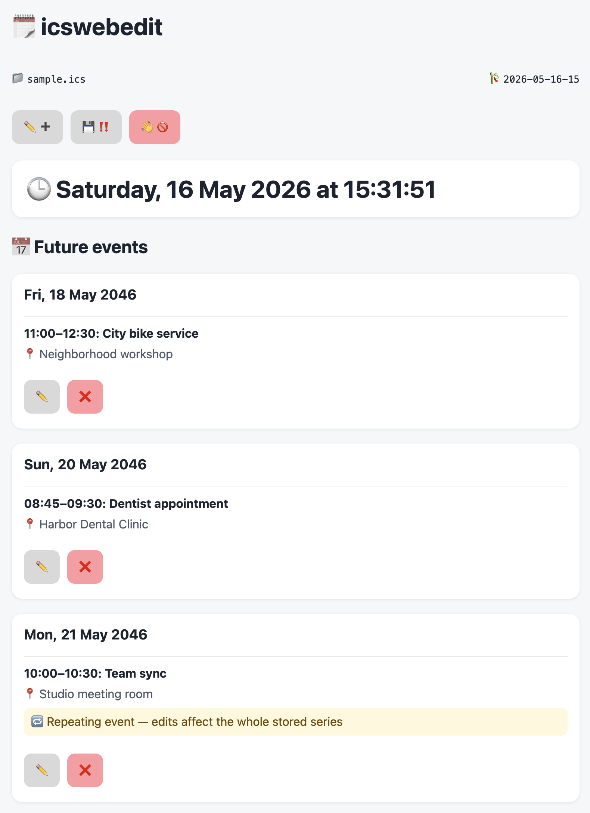
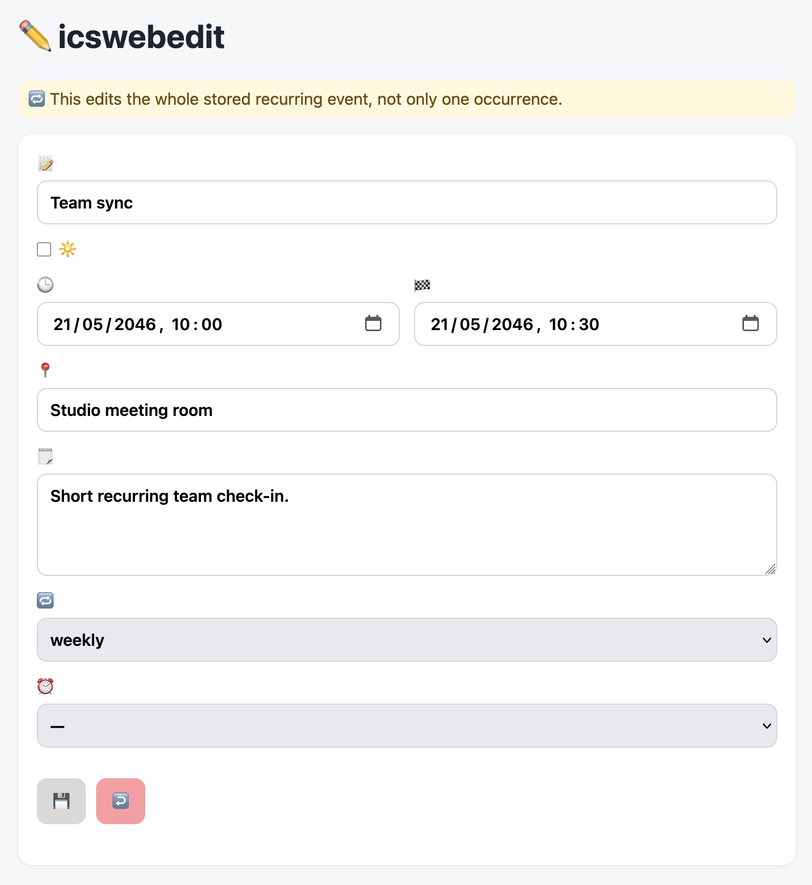

# icswebedit

> [!WARNING]
>
> Test `icswebedit` on copies of your calendars and keep backups. Do not trust
> it blindly with important calendar data.

`icswebedit` is a tiny local web app for editing one `.ics` calendar file in a
browser.

## Preview

### Overview



### Details



## What it does

- runs as a single-file script via `pipx run`
- serves a local browser UI on `127.0.0.1`
- edits a temporary session first
- only writes the real `.ics` file when you press **Save**

## Features

- local-only browser UI bound to `127.0.0.1`
- single-file executable script with `pipx run`
- add, edit, and delete calendar events
- timed and all-day event support
- recurring events with simple frequency options
- alarm lead-time dropdown
- browser-local editing for timed events
- live digital home-page clock
- hardcoded top-right version stamp for shipped code changes
- future-events overview, including recurring events
- temporary session file so the original calendar is unchanged until **Save**
- automatic backup creation on save
- automatic cleanup of past non-recurring events on save
- automatic browser-language translations with no language menu required
- simple macOS Shortcut / Dock-launch workflow
- dark-mode support
- emoji-heavy interface with lightweight styling

## Supported languages

The UI uses the browser language automatically. There is no manual language
switcher.

Built-in translations are provided for:

- English
- German
- Spanish
- Dutch
- Italian
- French
- Portuguese
- Chinese
- Japanese
- Korean
- Russian
- Arabic
- Hindi

## Requirements

- `pipx`
- Python 3.12 or newer
- `make`, only for the optional macOS/Linux installation below

## Install

On macOS and Linux, from a checkout of this repository:

```sh
make install
```

This creates `$HOME/.local/bin/icswebedit` as a symlink to the absolute path of
the executable script in this checkout. It does not use `sudo` and does not
install dependencies.

`pipx` must already be on `PATH`. `$HOME/.local/bin` must also be on `PATH`. If
it is not, add it for the current shell:

```sh
export PATH="$HOME/.local/bin:$PATH"
```

Persist that in your shell configuration if you want it to survive new sessions.

After installation, run:

```sh
icswebedit /path/to/calendar.ics
```

Keep this checkout in place. Moving or deleting it breaks the symlink.

Installation skips an existing file, directory, or symlink (including a broken
symlink) at `$HOME/.local/bin/icswebedit` and leaves it untouched. Edits to the
script in an already-linked checkout apply without reinstalling.

From the same checkout:

```sh
make uninstall
```

This removes only this checkout's symlink. The repository and calendar files are
left intact.

## Run

You can also run the script from the checkout without installing:

```sh
pipx run ./icswebedit /path/to/calendar.ics
```

If you want to try the included sample calendar first:

```sh
cp example.ics sample.ics
pipx run ./icswebedit sample.ics
```

Optional port:

```sh
pipx run ./icswebedit /path/to/calendar.ics 8765
```

When it starts, it prints one local listening message such as:

```text
Listening on http://127.0.0.1:8765/
```

Open that URL in your browser.

## Data safety

- edits go to a temporary session file first
- the original calendar is untouched until **Save**
- saving creates a backup before replacing the original file
- newly created or edited events are written as busy (`TRANSP:OPAQUE`)
- on **Save**, old past non-recurring events are automatically removed from the
  `.ics` file to keep it tidy and to stop it growing forever
- recurring events are never auto-deleted
- recurring events do not support `COUNT`; if a recurring series is no longer
  needed, you must delete it yourself eventually
- the bundled `example.ics` and `sample.ics` reflect this by using open-ended
  recurring rules instead of `COUNT`
- you should still make your own backups

## macOS Shortcut / Dock icon

All hardcoded values below are examples. Replace them with your own calendar
path and preferred port.

The example assumes `make install`. You can instead set `SCRIPT` to the absolute
path of the `icswebedit` script in this repository. `pipx` must be on `PATH` in
the Shortcut environment as well.

Create a Shortcut in the Shortcuts app with a single **Run Shell Script**
action.

Use this shell script:

```sh
SCRIPT="$HOME/.local/bin/icswebedit"
ICS="$HOME/Calendars/personal-calendar.ics"
PORT=8765
URL="http://127.0.0.1:$PORT/"

if ! nc -z 127.0.0.1 "$PORT" >/dev/null 2>&1; then
    nohup "$SCRIPT" "$ICS" "$PORT" >/dev/null 2>&1 &
    sleep 1
fi

open "$URL"
```

To get a Dock icon:

1. Open the Shortcut.
2. Use the Shortcut details/share menu.
3. Choose **Add to Dock**.

This creates a Dock icon that launches the Shortcut without showing Terminal.

## Development

The application is a single-file script with an embedded UI. There is no build
step.

Use disposable calendars for manual checks.

`VERSION` in `icswebedit` uses the format `YYYY-MM-DD-HH` and reflects the last
shipped application code change. Bump it when application code changes, not for
documentation-only edits.

Format touched supported files with the existing `dprint.json`. Keep README
feature descriptions aligned with shipped behavior.

## History

[`SPEC.md`](SPEC.md) preserves the original implementation specification. It is
historical and may differ from current behavior. It is not maintained as a
development contract.
